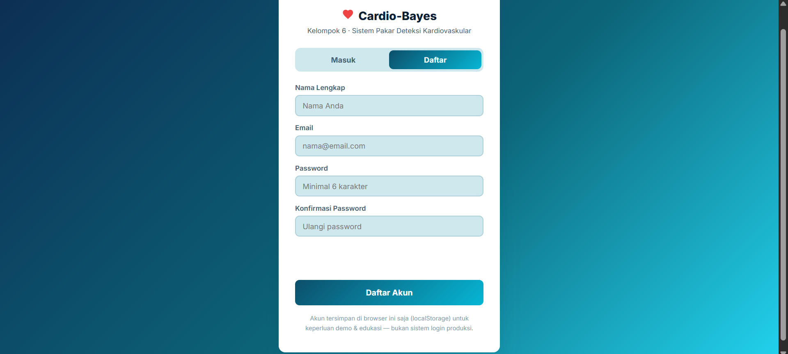
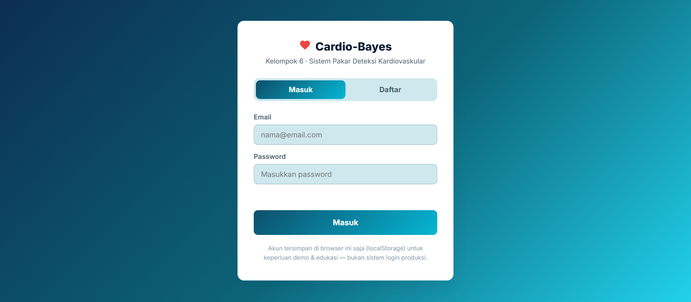
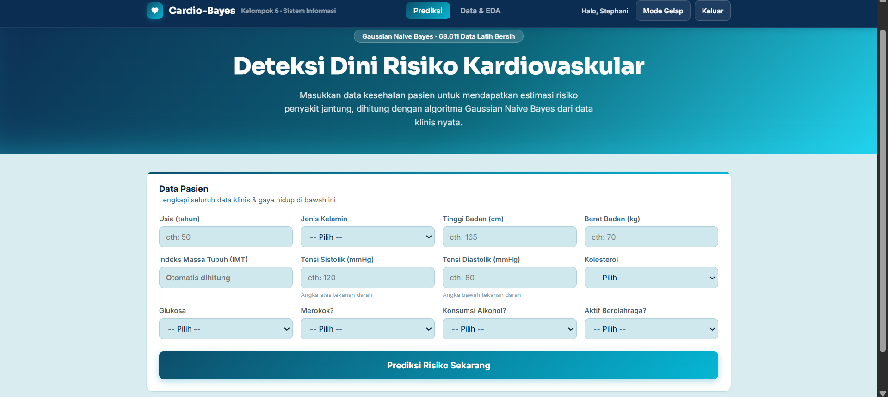
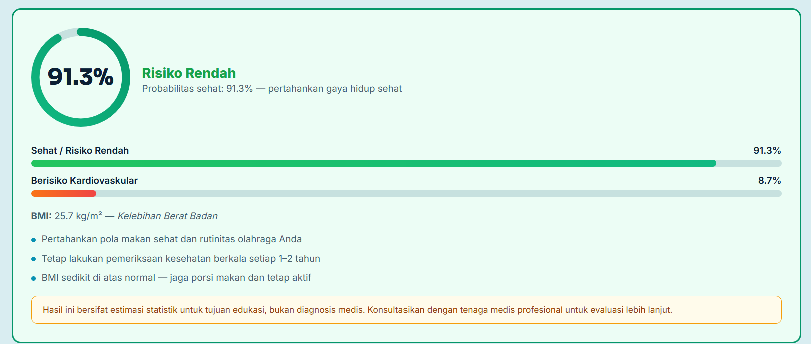
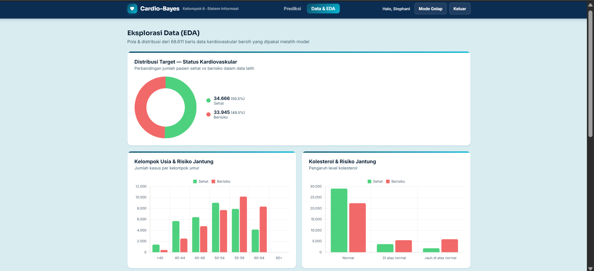
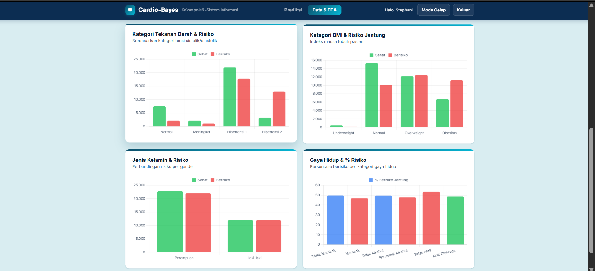

# 🩺 Cardio-Bayes — Deteksi Dini Risiko Kardiovaskular

<div align="center">

[]()
[]()
[]()
[]()

*Sistem pakar berbasis probabilitas statistik untuk melakukan estimasi awal risiko penyakit kardiovaskular secara interaktif, cepat, dan berbasis data medis nyata.*

</div>

---

## Tentang Web

**Cardio-Bayes** adalah aplikasi web interaktif yang saya kembangkan untuk membantu melakukan deteksi dini risiko penyakit jantung. Aplikasi ini menerapkan algoritma klasifikasi probabilistik **Gaussian Naive Bayes** yang dilatih menggunakan dataset rekam medis kesehatan berskala besar (**68.611 data latih bersih**).

Melalui antarmuka modern yang responsif (dilengkapi *Dark Mode*), pengguna dapat memasukkan parameter klinis pribadi seperti usia, tekanan darah, indeks massa tubuh (IMT/BMI), kolesterol, glukosa, hingga kebiasaan gaya hidup untuk melihat probabilitas risiko kesehatan jantung secara instan.

---

## Fitur Utama

* **Sistem Autentikasi Pengguna:** Dilengkapi fitur Masuk dan Daftar berbasis `localStorage` untuk personalisasi sesi pengguna.
* **Kalkulator Prediksi Real-Time:** Menghitung probabilitas status *Sehat* vs *Berisiko* menggunakan persamaan Gaussian Naive Bayes secara instan di sisi *client-side*.
* **Perhitungan IMT Otomatis:** Otomatis menghitung Indeks Massa Tubuh berdasarkan tinggi dan berat badan lengkap dengan indikator kategorinya.
* **Dashboard Eksplorasi Data (EDA):** Visualisasi data interaktif menggunakan *Chart.js* untuk melihat distribusi target, kelompok usia, kolesterol, tekanan darah, hingga korelasi gaya hidup terhadap risiko jantung.
* **Mode Gelap (Dark Mode):** Kenyamanan visual ekstra dengan tombol pengalih tema terang dan gelap yang dinamis.

---

## Tampilan Web

> *Berikut adalah dokumentasi antarmuka dari aplikasi Cardio-Bayes:*

### 1. Halaman Autentikasi (Daftar)


### 1. Halaman Autentikasi (Masuk)


### 2. Antarmuka Utama & Form Input Data Pasien


### 3. Hasil Analisis & Ringkasan Probabilitas Risiko


### 4. Dashboard Eksplorasi Data (EDA) — Distribusi & Usia


### 5. Visualisasi Pengaruh Kolesterol & Tekanan Darah


---

## Struktur Teknologi

* **Frontend:** HTML5, CSS3 (Custom Properties & Glassmorphism design), JavaScript (ES6+).
* **Visualisasi Grafik:** [Chart.js v4.4.1](https://www.chart.js/)
* **Model Machine Learning:** Gaussian Naive Bayes (parameter *prior*, *theta*, dan *variance* dari pelatihan Python/Scikit-Learn).
* **Penyimpanan Lokal:** Browser `localStorage` untuk manajemen sesi & autentikasi ringan.

---

## Cara Menjalankan Proyek (Quick Start)

Proyek ini dibangun murni berbasis web statis yang cerdas tanpa memerlukan instalasi *backend* yang rumit:

1. **Clone repository ini:**
   ```bash
   git clone [https://github.com/stephani689/Cardio-Bayes.git](https://github.com/stephani689/Cardio-Bayes.git)
